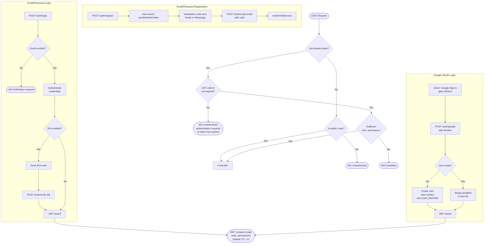
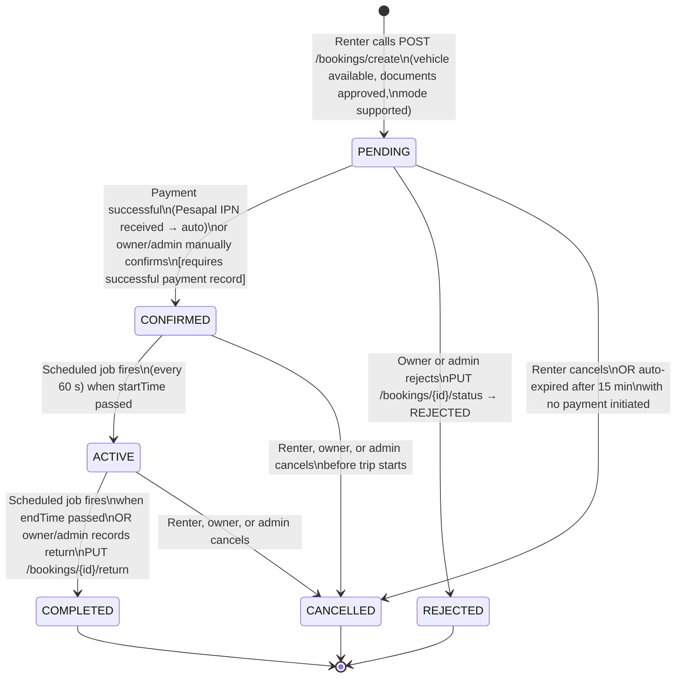
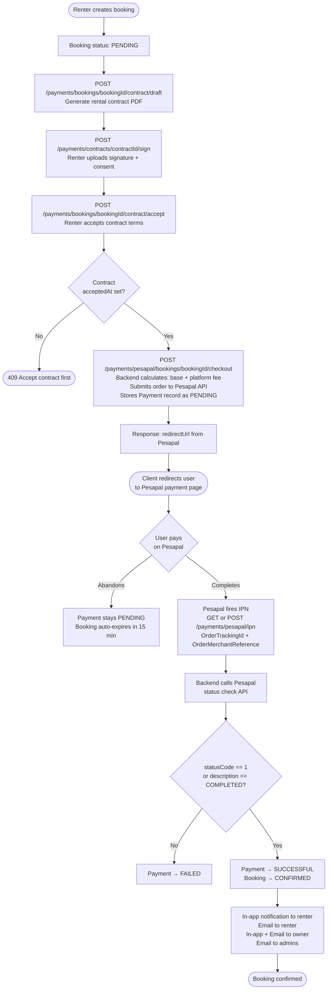
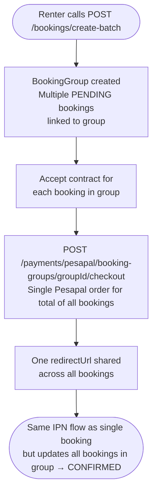
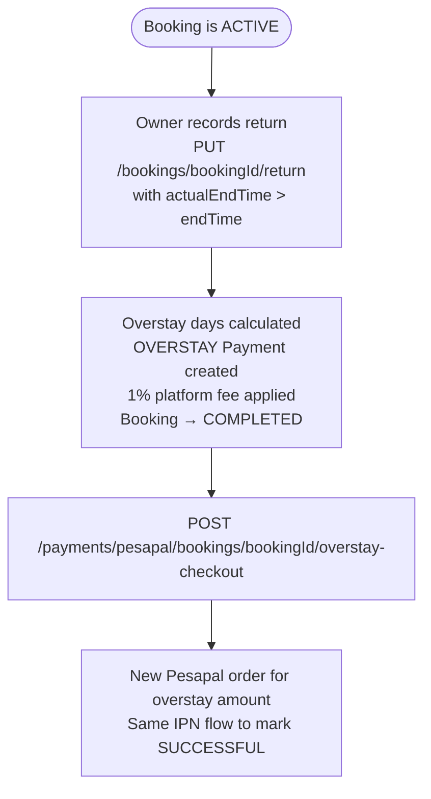

# Ramellian Executive Travels — Backend API Integration Guide

**Version:** 1.0 · **Date:** 2026-10-05 · **Base path:** `/api/v1`

---

## 1. Overview

The Ramellian Executive Travels backend is a RESTful API that powers an executive vehicle rental marketplace connecting **car owners**, **renters**, and **chauffeurs** in Kenya. It handles the full lifecycle from vehicle listing and discovery through booking, contract signing, Pesapal payment processing, vehicle handover, and post-trip overstay reconciliation.

**Tech Stack**

| Layer | Technology |
|---|---|
| Runtime | Java 21 (virtual threads enabled) |
| Framework | Spring Boot 3 |
| Database | PostgreSQL 14+ |
| Auth | JWT (HS256) + Google OAuth 2.0 (ID token verification) |
| Payments | Pesapal v3 (sandbox: `cybqa.pesapal.com`) |
| File Storage | Local disk (configurable via env vars) |
| Email | SMTP via Spring Mail (Gmail by default) |
| WhatsApp | Meta Graph API (optional, disabled by default) |
| API Docs | Springdoc OpenAPI / Swagger UI at `/swagger-ui.html` |

---

## 2. Authentication Flow

### 2.1 How JWTs are validated

Every request passes through `JwtAuthenticationFilter` before it reaches a controller. The filter extracts the `Authorization: Bearer <token>` header, validates the signature using the configured secret, loads the user from the database, and injects a `UsernamePasswordAuthenticationToken` into the `SecurityContext`. Spring Security then evaluates the route's access rules against the token's authorities (roles + granular permissions).

Sessions are **stateless** — no HTTP session is created or used.

### 2.2 Authentication flowchart

**Public routes (no token required):**
- `GET /api/v1/vehicles`, `GET /api/v1/vehicles/**`
- `POST /api/v1/bookings/quote`
- `POST /api/v1/booking-leads`
- `GET /api/v1/rental-terms/**`
- `GET /api/v1/contract-templates/owners/*/active`
- `GET /api/v1/vehicles/*/photos`
- `GET|POST /api/v1/payments/pesapal/ipn`
- `/uploads/**` (served files)
- `/swagger-ui/**`, `/v3/api-docs/**`

---

## 3. Booking Lifecycle

### 3.1 Status state diagram

### 3.2 Who can trigger each transition

| From | To | Who | Mechanism |
|---|---|---|---|
| — | PENDING | Any authenticated user (self) or staff with `BOOKING_MANAGE` (on behalf) | `POST /bookings/create` |
| PENDING | CONFIRMED | Owner or `BOOKING_MANAGE` staff only after successful payment | `PUT /bookings/{id}/status` |
| PENDING | CONFIRMED | Automatic | Pesapal IPN callback |
| PENDING | REJECTED | Owner or `BOOKING_MANAGE` staff | `PUT /bookings/{id}/status` |
| PENDING | CANCELLED | Renter, owner, or `BOOKING_MANAGE` staff | `PUT /bookings/{id}/status` |
| PENDING | CANCELLED | Automatic scheduler | No payment after 15 min (configurable) |
| CONFIRMED | ACTIVE | Automatic scheduler | Every 60 s, checks `startTime < now` |
| CONFIRMED | CANCELLED | Renter, owner, or `BOOKING_MANAGE` staff | `PUT /bookings/{id}/status` |
| ACTIVE | COMPLETED | Automatic scheduler | Checks `endTime < now` |
| ACTIVE | COMPLETED | Owner or `BOOKING_MANAGE` staff | `PUT /bookings/{id}/return` |
| ACTIVE | CANCELLED | Renter, owner, or `BOOKING_MANAGE` staff | `PUT /bookings/{id}/status` |

---

## 4. Payment Flow (Pesapal Integration)

### 4.1 Single-booking payment

### 4.2 Batch (group) booking payment

### 4.3 Overstay payment

### 4.4 Fee calculation

| Component | Formula |
|---|---|
| Base amount | `vehicle.pricePerDay × ceil(hours / 24)` (minimum 1 day) |
| Platform fee | `base × commissionRate / 100` (configurable, default 2%) |
| Renter total | `base + platformFee` |
| Owner payout | `base` (before platform fee) |
| Overstay | `pricePerDay × overstayDays` with 1% platform fee |

---

## 5. Role and Permission Matrix

### 5.1 Roles

| Role constant | Spring role | Description |
|---|---|---|
| `CAR_RENTER` | `ROLE_CAR_RENTER` | Can create bookings and pay |
| `CAR_OWNER` | `ROLE_CAR_OWNER` | Can list vehicles and view own bookings |
| `CHAUFFEUR` | `ROLE_CHAUFFEUR` | Can access chauffeur-specific routes |
| `ADMIN` | `ROLE_ADMIN` | Platform administrator |
| `SUPER_ADMIN` | `ROLE_SUPER_ADMIN` | Full access, bypasses all permission guards |

### 5.2 Granular permissions

| Permission | Guards |
|---|---|
| `BOOKING_MANAGE` | Admin-level booking operations, reports, status changes |
| `BOOKING_UPDATE` | Assign chauffeur |
| `BOOKING_DELETE` | `DELETE /bookings/**` |
| `VEHICLE_CREATE` | Create vehicle listings |
| `VEHICLE_UPDATE` / `VEHICLE_MANAGE` | Update vehicles, manage contract templates, booking policies |
| `VEHICLE_REVIEW` / `VEHICLE_APPROVE` | Approve or reject vehicle listings |
| `VEHICLE_READ` | Read vehicle details (protected routes) |
| `VEHICLE_DELETE` | `DELETE /vehicles/**` |
| `DOCUMENT_REVIEW` | Review uploaded ID / licence documents |
| `PAYMENT_MANAGE` | Full payment admin access |
| `PAYMENT_DELETE` | `DELETE /payments/**` |
| `REVIEW_CREATE` | Post vehicle reviews |
| `REVIEW_READ` | Read vehicle reviews |

### 5.3 Resource access matrix

| Resource | CAR_RENTER | CAR_OWNER | CHAUFFEUR | ADMIN | SUPER_ADMIN |
|---|---|---|---|---|---|
| Browse vehicles (public) | Yes | Yes | Yes | Yes | Yes |
| Create vehicle listing | No | Yes | No | Yes | Yes |
| Approve vehicle | No | No | No | Yes | Yes |
| Create booking | Yes | Yes | No | Yes | Yes |
| View own bookings | Yes | Via `/owner` | No | Yes | Yes |
| Confirm / reject booking | No | Yes (own vehicles) | No | Yes | Yes |
| Cancel booking | Yes (own) | Yes (own vehicles) | No | Yes | Yes |
| Admin booking report | No | No | No | Yes | Yes |
| Initiate Pesapal checkout | Yes (own) | No | No | No | Yes |
| View payment status | Yes (own) | Yes (own vehicles) | No | Yes | Yes |
| Review documents | No | No | No | Yes | Yes |
| Record vehicle return | No | Yes | No | Yes | Yes |
| Assign chauffeur | No | Yes (own vehicles) | No | Yes | Yes |
| Platform commission settings | No | No | No | No | Yes |

---

## 6. Key API Endpoints

### 6.1 Authentication — all public

| Method | Path | Description |
|---|---|---|
| `POST` | `/auth/register` | Register with email/password; triggers verification code |
| `POST` | `/auth/verify-email` | Verify email with code |
| `POST` | `/auth/resend-verification` | Resend email or WhatsApp code |
| `POST` | `/auth/login` | Email/password login; returns JWT or 2FA challenge |
| `POST` | `/auth/verify-2fa` | Complete 2FA challenge; returns JWT |
| `POST` | `/auth/google` | Google OAuth: submit Google `idToken`; returns JWT |

### 6.2 Vehicles

| Method | Path | Auth | Description |
|---|---|---|---|
| `GET` | `/vehicles` | None | List/search approved vehicles |
| `GET` | `/vehicles/{id}` | None | Get vehicle by ID |
| `GET` | `/vehicles/me` | Authenticated | Caller's own vehicle listings |
| `POST` | `/vehicles/create-vehicle` | `VEHICLE_CREATE` | Create vehicle listing (status: PENDING) |
| `PUT` | `/vehicles/{id}` | `VEHICLE_UPDATE` | Update vehicle details |
| `DELETE` | `/vehicles/{id}` | `VEHICLE_DELETE` | Delete vehicle |
| `PUT` | `/vehicles/{id}/review` | `VEHICLE_REVIEW` | Approve / reject vehicle |
| `GET` | `/vehicles/admin/pending` | `VEHICLE_REVIEW` | Vehicles awaiting approval |
| `GET` | `/vehicles/{id}/photos` | None | Vehicle photos |

### 6.3 Bookings

| Method | Path | Auth | Description |
|---|---|---|---|
| `POST` | `/bookings/quote` | None | Get price estimate |
| `POST` | `/bookings/create` | Authenticated | Create a single booking |
| `POST` | `/bookings/create-batch` | Authenticated | Create batch booking group |
| `GET` | `/bookings/mine` | Authenticated | Caller's bookings as renter |
| `GET` | `/bookings/owner` | Authenticated | Bookings for caller's vehicles |
| `GET` | `/bookings/{id}` | Authenticated | Get booking detail |
| `PUT` | `/bookings/{id}/status` | Authenticated | Change booking status |
| `PUT` | `/bookings/{id}/chauffeur` | Owner / `BOOKING_MANAGE` | Assign a chauffeur |
| `PUT` | `/bookings/{id}/return` | Owner / `BOOKING_MANAGE` | Record vehicle return |
| `GET` | `/bookings/reports/mine` | Authenticated | Renter booking report |
| `GET` | `/bookings/reports/owner` | Authenticated | Owner booking report |
| `GET` | `/bookings/reports/admin` | `BOOKING_MANAGE` | Platform-wide booking report |

### 6.4 Payments and Contracts

| Method | Path | Auth | Description |
|---|---|---|---|
| `POST` | `/payments/bookings/{id}/contract/draft` | Authenticated | Generate rental contract PDF |
| `POST` | `/payments/contracts/{id}/sign` | Authenticated | Upload renter signature |
| `POST` | `/payments/bookings/{id}/contract/accept` | Authenticated | Accept contract terms |
| `GET` | `/payments/contracts/{id}/document` | Authenticated | Download contract PDF |
| `POST` | `/payments/pesapal/bookings/{id}/checkout` | Authenticated | Initiate Pesapal checkout |
| `GET` | `/payments/pesapal/bookings/{id}/status` | Authenticated | Poll payment status |
| `POST` | `/payments/pesapal/booking-groups/{id}/checkout` | Authenticated | Checkout for batch group |
| `POST` | `/payments/pesapal/bookings/{id}/overstay-checkout` | Authenticated | Pay overstay charge |
| `GET\|POST` | `/payments/pesapal/ipn` | **Public** | Pesapal IPN webhook callback |

### 6.5 Documents

| Method | Path | Auth | Description |
|---|---|---|---|
| `POST` | `/documents` | Authenticated | Upload identity document |
| `GET` | `/documents/me` | Authenticated | Caller's documents |
| `GET` | `/documents/admin/pending` | `DOCUMENT_REVIEW` | Documents awaiting review |
| `PUT` | `/documents/admin/{id}/review` | `DOCUMENT_REVIEW` | Approve or reject document |

### 6.6 Handovers

| Method | Path | Auth | Description |
|---|---|---|---|
| `POST` | `/handovers/bookings/{id}/pickup` | Authenticated | Record pickup handover |
| `POST` | `/handovers/bookings/{id}/dropoff` | Authenticated | Record dropoff handover |
| `GET` | `/handovers/bookings/{id}` | Authenticated | List handover records |

---

## 7. Environment Configuration

| Environment Variable | Default | Notes |
|---|---|---|
| `GOOGLE_CLIENT_ID` | _(dev client ID)_ | Google OAuth 2.0 client |
| `JWT_SECRET` | `change-this-...` | **Change in production.** Min 32 chars |
| `JWT_EXPIRATION_MS` | `3600000` | Token TTL in ms (1 hour) |
| `PESAPAL_BASE_URL` | `https://cybqa.pesapal.com/pesapalv3` | **Sandbox** — change for production |
| `PESAPAL_CONSUMER_KEY` | Sandbox key | From Pesapal dashboard |
| `PESAPAL_CONSUMER_SECRET` | Sandbox secret | From Pesapal dashboard |
| `PESAPAL_CALLBACK_URL` | `http://localhost:5173/payment/success` | Frontend redirect after payment |
| `PESAPAL_NOTIFICATION_ID` | Sandbox UUID | IPN notification ID from Pesapal |
| `MANUAL_PAYMENT_CONFIRMATION_ENABLED` | `false` | Allow manual confirmations without IPN |
| `CORS_ALLOWED_ORIGINS` | `http://localhost:3000,http://localhost:5173` | Comma-separated |
| `PENDING_BOOKING_EXPIRATION_MS` | `900000` | 15 min — unpaid bookings auto-cancelled |
| `FRONTEND_URL` | `http://localhost:5173` | Used in email CTA links |
| `SERVER_URL` | `http://localhost:8080` | Used in email logo and file URLs |
| `EMAIL_CURRENCY` | `KES` | Currency label in notification emails |
| `SUPER_ADMIN_EMAIL` | `superadmin@ramellian.com` | Seeded on startup |
| `SUPER_ADMIN_PASSWORD` | `SuperAdmin@12345` | **Change in production** |
| `SMTP_HOST` | `smtp.gmail.com` | |
| `SMTP_PORT` | `587` | STARTTLS |
| `SMTP_USERNAME` | _(dev Gmail)_ | **Set your own in production** |
| `SMTP_PASSWORD` | _(dev app password)_ | **Set your own in production** |
| `WHATSAPP_ENABLED` | `false` | Enable Meta WhatsApp notifications |
| `VERIFICATION_CODE_EXPIRATION_MINUTES` | `15` | OTP / 2FA code TTL |
| `VEHICLE_PHOTO_DIRECTORY` | `uploads/vehicles` | File storage path |
| `DOCUMENT_DIRECTORY` | `uploads/documents` | |
| `CONTRACT_DIRECTORY` | `uploads/contracts` | |
| `HANDOVER_DIRECTORY` | `uploads/handovers` | |

**Database defaults:**

| Property | Default |
|---|---|
| `spring.datasource.url` | `jdbc:postgresql://localhost:5433/ramellian-executive-travels` |
| `spring.datasource.username` | `postgres` |
| `spring.datasource.password` | `root` |
| `spring.jpa.hibernate.ddl-auto` | `update` |

---

## 8. Email Notifications

| Trigger | Recipients | Content |
|---|---|---|
| User registers | Registering user | Email verification code (15 min TTL) |
| 2FA login | Authenticating user | Two-factor code |
| Booking → PENDING | Renter, all ADMINs, vehicle owner (in-app only) | New booking alert |
| Booking → CONFIRMED | Renter | Confirmation email with trip details and CTA |
| Booking → CONFIRMED | Vehicle owner | Booking email with earnings / payout breakdown |
| Booking → CONFIRMED | All ADMINs / SUPER_ADMINs | Admin notification email |
| Status changes | Renter | In-app: "Your booking is now [STATUS]" |

---

## 9. Document Verification Requirements

Before a booking can be created the renter's identity documents must be approved:

| Booking Mode | Required |
|---|---|
| `SELF_DRIVE` | Approved national ID **or** passport + approved driving licence |
| `CHAUFFEURED` | Approved national ID **or** passport |

Documents flow: `PENDING` → `APPROVED` / `REJECTED` via `PUT /documents/admin/{id}/review`.

---

## 10. Scheduled Background Jobs

| Job | Frequency | Behaviour |
|---|---|---|
| `transitionBookingStatuses` | Every 60 s | CONFIRMED bookings past `startTime` → ACTIVE; ACTIVE bookings past `endTime` → COMPLETED |
| `expireUnpaidPendingBookings` | Every 15 min (configurable) | PENDING bookings older than TTL with no successful payment → CANCELLED |

---

## 11. Pre-flight Checklist for Production

- [ ] Set `JWT_SECRET` to a strong random 64+ character string
- [ ] Set `SUPER_ADMIN_PASSWORD` to a strong password
- [ ] Replace `SMTP_USERNAME` / `SMTP_PASSWORD` with production mail credentials
- [ ] Set `PESAPAL_BASE_URL` to `https://pay.pesapal.com/v3`
- [ ] Set `PESAPAL_CONSUMER_KEY`, `PESAPAL_CONSUMER_SECRET`, `PESAPAL_NOTIFICATION_ID` from Pesapal production dashboard
- [ ] Set `PESAPAL_CALLBACK_URL` to the live frontend success URL
- [ ] Register `{SERVER_URL}/api/v1/payments/pesapal/ipn` as the IPN notification URL in your Pesapal account
- [ ] Set `CORS_ALLOWED_ORIGINS` to your production frontend domain(s)
- [ ] Set `FRONTEND_URL` and `SERVER_URL` to production URLs
- [ ] Set `spring.jpa.hibernate.ddl-auto=validate` (use migrations in production)
- [ ] Set `server.error.include-stacktrace=never` and `logging.level.root=WARN`
